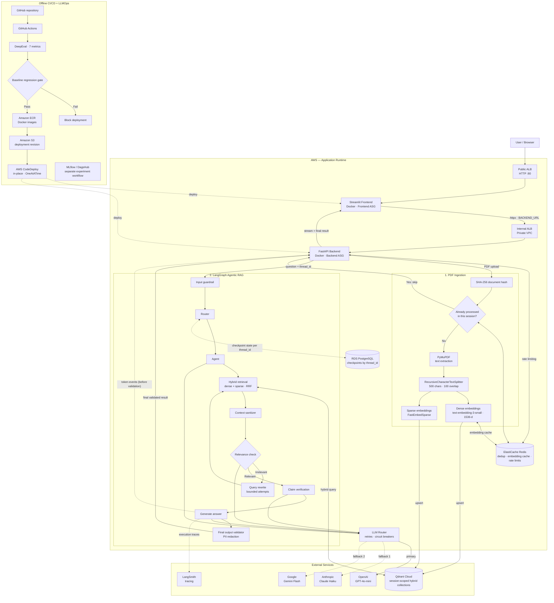

# 🚀 VeriRAG-Pro — Agentic RAG with Production-Oriented LLMOps

### Scientific claim verification with an agentic RAG pipeline, automated evaluation gates, and a multi-tier AWS deployment


---

## 📖 What is VeriRAG-Pro?

**VeriRAG-Pro** is the production-oriented evolution of **[VeriRAG](https://github.com/akashagalave/VeriRAG)**, an agentic RAG system that verifies scientific claims against retrieved evidence.

```
LangGraph  ·  Hybrid Retrieval (dense + sparse BM25)  ·  RRF Fusion
Relevance Grading  ·  Query Rewriting  ·  Evidence-Grounded Generation
```

It wraps that pipeline with engineering layers most GenAI projects skip: guardrails, Redis caching and deduplication, persistent session state, multi-provider LLM reliability, a DeepEval regression gate, experiment tracking, and tracing.

### Status legend

| Label | Meaning |
|---|---|
| ✅ **Implemented** | Built and working in the codebase |
| ☁️ **Verified on AWS** | Inspected or measured on the deployed infrastructure |
| 🔭 **Planned** | Future scope, not yet built or verified |

---

## 🧠 System Architecture

The diagram separates three concerns: the **application runtime** (ingestion and query paths), **external services**, and the **offline CI/CD pipeline**.



**Reading the diagram**
- Solid arrows are request and data paths. Dotted arrows are indirect links: token streaming, provider fallbacks, checkpointing, traces, and deployments.
- **Ingestion:** each upload is hashed with SHA-256 and checked against Redis for the current session. New documents are parsed with PyMuPDF, split into 500-character chunks with 100 overlap, embedded with dense and sparse models, and upserted into a session-scoped Qdrant hybrid collection.
- **Query:** the context sanitizer runs after retrieval and before the relevance check. Query rewriting is bounded, so the retrieval loop cannot run indefinitely.
- **Checkpointing:** LangGraph persists graph state to RDS PostgreSQL keyed by `thread_id` throughout execution. The edge on the Router node represents the whole graph.
- **Streaming:** `generate` emits token events to the API **before** the final validator runs. The validated final result is sent separately (see [guardrail limitations](#1--three-layer-genai-guardrails--implemented)).
- **MLflow** tracking runs as a separate experiment workflow. It is not part of the CI deployment gate.

---

## 🔧 Key Features

### 1. 🔒 Three-Layer GenAI Guardrails — ✅ Implemented

| Layer | What it does | Fail policy |
|---|---|---|
| Input Guardrail | Pattern-based detection of prompt injection and jailbreak attempts before the graph runs | Fail-closed → HTTP 400 |
| Context Sanitizer | Strips hidden instructions from retrieved chunks to reduce retrieval-poisoning risk | Fail-open → log and continue |
| Output Validator | Scans the final response for PII (email, phone, SSN, Aadhaar) and redacts it | Fail-open → redact and continue |

**Known limitations**
- The context sanitizer is a **best-effort defense**, not a guarantee against prompt injection.
- **Final output validation runs after token streaming**, so streamed tokens can reach the client before redaction is applied. A streaming-safe validator is 🔭 planned.

### 2. 📊 Evaluation Regression Gate — ✅ Implemented

DeepEval scores the RAG pipeline offline on **7 metrics**. CI compares each candidate run against an **approved, saved baseline** and fails on regression.

**Dataset:** a fixed set of **10 research-paper questions** derived from *Attention Is All You Need*, executed against the VeriRAG-Pro workflow. The set is small and single-document, so these scores show regression stability rather than general accuracy.

| Metric | Baseline score |
|---|---|
| Faithfulness | **0.9479** |
| Answer Relevancy | **0.9562** |
| Contextual Precision | **0.9833** |
| Contextual Recall | **0.8750** |
| Contextual Relevancy | **0.6726** |
| Answer Correctness (G-Eval) | **0.8187** |
| Simple Explanation (G-Eval) | **0.9066** |

Contextual Relevancy (0.6726) is the weakest metric: retrieval returns the right evidence (high recall and precision) but also brings in some unrelated content per chunk.

**Evaluation workflow**

| Step | Script | Responsibility |
|---|---|---|
| 1 | `generate_eval_dataset.py` | Runs the RAG workflow and captures answers and retrieved contexts |
| 2 | `evaluate_rag_app.py` | Scores the captured cases with DeepEval |
| 3 | `evaluate.py --ci` | Compares scores against the approved baseline and exits `1` on regression |

```bash
python generate_eval_dataset.py     # 1. capture RAG outputs
python evaluate_rag_app.py          # 2. score with DeepEval
python evaluate.py --ci             # 3. regression check vs. baseline (exit 1 on regression)
```

**Experiment tracking (separate workflow):** MLflow runs are orchestrated by `execute_experiment_pipeline.py`. It uses `mlflow_tracking.py` as its tracking module to log parameters, metrics, and artifacts to DagsHub. See `execute_experiment_pipeline.py` for its arguments. This workflow is **not** part of the CI deployment gate.

**Baseline and tolerance**
- **Baseline file:** `reports/evaluation/attention_metrics_k3_baseline.json`. It is an approved reference and is **never overwritten automatically**, since replacing it on every run would defeat regression detection.
- **Tolerance:** the development-stage gate fails when any metric **decreases by more than 0.15** absolute points relative to the baseline. For example, the Faithfulness cutoff is about **0.7979** (0.9479 − 0.15), so a run scoring 0.80 still passes. This is a regression policy, **not** a guaranteed minimum quality level.

### 3. ⚡ Redis Caching & Deduplication — ✅ Implemented

Redis (AWS ElastiCache) serves three namespaced purposes:

| Use | Path | How it works |
|---|---|---|
| **Document dedup** | Ingestion | SHA-256 of the raw file bytes → Redis lookup, scoped to the session. A hit skips parsing and embedding entirely |
| **Embedding cache** | Ingestion | `CacheBackedEmbeddings` on a Redis store (blake2b-keyed). Previously seen chunks reuse cached dense vectors |
| **Rate limiting** | API | Shared counter, so the limit applies across instances rather than per process |

**Redis cache monitoring — ☁️ Verified on AWS**

During AWS testing, Redis `INFO stats` reported **2,004 keyspace hits and 1,084 misses**, a **64.9% aggregate keyspace hit rate**.

This figure covers all Redis activity across features. It is **not** the embedding-cache hit rate and **not** a direct percentage reduction in API cost.

### 4. 🔄 Multi-Provider LLM Routing & Reliability — ✅ Implemented

Model calls from the graph's LLM nodes go through a provider-agnostic router with retries, fallback, and per-provider circuit breakers:

```
OpenAI GPT-4o-mini (primary) → Anthropic Claude Haiku (fallback 1) → Google Gemini Flash (fallback 2)
```

```
CLOSED    → healthy, requests go through
OPEN      → 3+ consecutive failures → block provider, try next
HALF-OPEN → after 60s → send one probe → on success, return to CLOSED
```

### 5. 🗄️ Persistent Session State — ✅ Implemented

LangGraph checkpoints are persisted in **PostgreSQL on AWS RDS**, keyed by `thread_id`. Conversation state survives restarts and is shared across backend instances. Local development falls back to SQLite when `DATABASE_URL` is unset.

### 6. 🔭 Observability & Experiment Tracking

| Capability | Tool | Status |
|---|---|---|
| Execution tracing across LangGraph nodes | LangSmith | ✅ Implemented |
| Offline quality evaluation (7 metrics) | DeepEval | ✅ Implemented |
| Experiment tracking: parameters, metrics, artifacts | MLflow / DagsHub | ✅ Implemented |
| Online (trace-based) evaluation of live traffic | LangSmith evaluators | 🔭 Planned. No evaluator results are published yet |
| Cache, latency, and ingestion dashboards | AWS monitoring | 🔭 Planned |

---

## 🧩 Key Architecture Decisions

| Decision | Why it was chosen | Trade-off |
|---|---|---|
| **LangGraph** | Explicit stateful orchestration with conditional routing and query-rewrite loops | More workflow complexity than a basic RAG chain |
| **Qdrant hybrid retrieval** | Combines semantic similarity with lexical matching using dense and sparse vectors | Extra indexing and query complexity |
| **GPT-4o-mini as primary** | Cost-conscious generation model for interactive RAG | Needs evaluation against stronger models on difficult claims |
| **Redis** | Shared document dedup, embedding caching, and rate limiting | Added infrastructure cost and cache-management complexity |
| **RDS PostgreSQL** | Durable LangGraph checkpoints independent of backend instances | Connection-pool and checkpoint-storage overhead |
| **EC2 ASGs + CodeDeploy** | Containerized AWS deployment with automated, quality-gated releases | More instance management than a fully managed container platform |
| **DeepEval + MLflow** | Separates RAG quality scoring from experiment tracking | LLM judges add cost and evaluation uncertainty |

These choices target reliable agentic RAG execution, measurable quality, and practical deployment rather than maximum architectural complexity.

---

## ☁️ AWS Deployment

Frontend and backend run as **separate EC2 Auto Scaling Groups**, each attached to its own Application Load Balancer target group. The full request path is shown in the [system architecture](#-system-architecture) diagram.

| Component | Status |
|---|---|
| Public ALB, HTTP:80 listener → frontend target group | ☁️ Verified |
| Frontend ASG (Streamlit), desired 1 / max 3 | ☁️ Verified |
| Internal ALB | ☁️ Verified to exist |
| Backend ASG (FastAPI), desired 1 / max 3 | ☁️ Verified |
| CodeDeploy in-place, `OneAtATime` configuration | ☁️ Verified |
| Frontend → internal ALB → backend routing | Designed. Listener rules and the frontend's `BACKEND_URL` not yet confirmed |
| HTTPS on the public ALB | 🔭 Planned. Not configured |

### Network security status

- The public listener uses **HTTP on port 80**. Browser-to-ALB traffic is **not encrypted** until an HTTPS listener with an ACM certificate is added.
- An internal ALB exists for private backend routing, but that alone does not prove network isolation. Backend isolation is **not claimed** until these are checked:
  - backend EC2 instances have no public IPs
  - backend security groups accept traffic only from the internal ALB
  - the frontend's `BACKEND_URL` points to the internal ALB
- No API keys or AWS credentials are committed. Secrets are supplied through environment configuration.

### CI/CD pipeline

```
GitHub push
   ↓
Job 1: eval-gate  → DeepEval evaluation + regression check vs. approved baseline
                    any metric drops by more than 0.15 → pipeline stops
   ↓
Job 2: build      → build Docker images, push to Amazon ECR,
                    upload deployment revision to S3
   ↓
Job 3: deploy     → AWS CodeDeploy (frontend ASG and backend ASG)
```

CodeDeploy runs **in-place with `OneAtATime`**. Each ASG currently runs one instance, so **zero-downtime rolling deployments have not been demonstrated**.

---

## 🧪 Testing and Verification

| Area | Evidence |
|---|---|
| **RAG quality** | DeepEval baseline report with seven metrics |
| **Regression detection** | GitHub Actions eval-gate results that block the deploy jobs |
| **Redis cache activity** | Redis `INFO stats`: 2,004 hits, 1,084 misses, 64.9% aggregate hit rate |
| **AWS deployment** | CodeDeploy deployment history and EC2 Auto Scaling Group configuration |
| **Execution tracing** | LangSmith traces |
| **Experiment tracking** | MLflow / DagsHub run parameters, metrics, and artifacts |
| **Input guardrail** | Injection attempt rejected with HTTP 400 |

Evaluation scores are offline results on a 10-question benchmark, not guarantees of production accuracy. The Redis aggregate hit rate does not directly represent embedding API cost savings. No throughput claim is made, because the system has not been load-tested.

---

## 📈 Scalability and Known Limitations

**Current limitations**
- PDF ingestion runs in the application request path rather than in a durable background queue.
- Session-scoped Qdrant collections add management overhead as the number of sessions grows.
- Embedding throughput is bounded by external API quotas.
- The deployment has not been load-tested, so no maximum sustainable request rate is established.
- Each ASG runs one instance, so zero-downtime rolling deployments are not demonstrated.
- Streamed tokens can reach the client before PII redaction.
- The public listener is HTTP-only, and backend network isolation is not yet verified.
- The evaluation set is 10 questions from a single paper.

**Planned improvements** 🔭
- Streaming-safe output validation (buffered or chunk-level redaction)
- HTTPS listener with an ACM certificate, plus verified backend security-group isolation
- Direct PDF uploads to S3 through presigned URLs
- S3 event notifications → SQS → dedicated ingestion workers, with retries and a dead-letter queue
- Independent scaling of parsing, embedding, and indexing
- Provider-aware RPM/TPM budgeting and concurrency controls
- Shared Qdrant collections with authorization-enforced tenant/session filtering where appropriate
- More than one instance per ASG with health-gated rolling deployments
- LangSmith online evaluators, latency monitoring, and cache/ingestion dashboards
- A larger, multi-document evaluation set

These are proposed improvements, not capabilities claimed as implemented.

---

## 🚀 Local Setup

```bash
git clone https://github.com/akashagalave/VeriRAG-Pro
cd VeriRAG-Pro

python -m venv venv
source venv/bin/activate   # Windows: venv\Scripts\activate
pip install -r requirements.txt

cp .env.example .env       # fill in your own keys; never commit .env

uvicorn backend.api:app --port 8000    # Terminal 1
streamlit run app.py                   # Terminal 2
```

### Docker Compose

```bash
docker compose up --build
```

---

## 🔑 Environment Variables

| Variable | Required | Description |
|---|---|---|
| `OPENAI_API_KEY` | ✅ | Primary LLM and embeddings |
| `QDRANT_URL` / `QDRANT_API_KEY` | ✅ | Qdrant Cloud endpoint and auth |
| `TAVILY_API_KEY` | ✅ | Web search for retrieval and claim verification |
| `REDIS_URL` | Optional | Enables Redis cache, dedup, and distributed rate limiting |
| `DATABASE_URL` | Optional | PostgreSQL for persistent sessions (SQLite fallback) |
| `BACKEND_URL` | Frontend | FastAPI endpoint the Streamlit frontend calls |
| `LANGSMITH_API_KEY` | Optional | LangSmith tracing |
| `MLFLOW_TRACKING_URI`, `DAGSHUB_*` | Optional | MLflow experiment tracking on DagsHub |
| `ANTHROPIC_API_KEY` | Optional | Claude Haiku fallback |
| `GOOGLE_API_KEY` | Optional | Gemini Flash fallback |

---

## 🧰 Tech Stack

| Category | Technology |
|---|---|
| Agent Orchestration | LangGraph StateGraph with conditional routing and shared state |
| LLM Integration | LangChain: GPT-4o-mini (primary), Claude Haiku, Gemini Flash (fallbacks) |
| LLM Reliability | Circuit breakers, exponential-backoff retries |
| PDF Parsing & Chunking | PyMuPDF, RecursiveCharacterTextSplitter (500 chars, 100 overlap) |
| Dense Embeddings | OpenAI text-embedding-3-small (1536-dim) |
| Sparse Embeddings | FastEmbed sparse (BM25), local |
| Vector DB | Qdrant Cloud: session-scoped hybrid collections, RRF fusion |
| Cache & Rate Limiting | Redis (AWS ElastiCache) |
| Session State | PostgreSQL (AWS RDS) with LangGraph checkpointing |
| Security | Three-layer guardrails: injection detection, context sanitizer, PII redaction |
| Evaluation | DeepEval (7 metrics, including G-Eval), baseline regression gate |
| Experiment Tracking | MLflow on DagsHub |
| Observability | LangSmith tracing |
| Serving | FastAPI (async, NDJSON streaming, Pydantic) |
| Frontend | Streamlit |
| Containerization | Docker |
| Deployment | AWS EC2 Auto Scaling Groups, public and internal ALBs, ECR, S3, CodeDeploy |
| CI/CD | GitHub Actions: eval-gate → build → deploy |

---

## 🔢 Key Numbers

| Metric | Value |
|---|---|
| Faithfulness (offline baseline) | 0.9479 |
| Answer Relevancy (offline baseline) | 0.9562 |
| Contextual Precision / Recall | 0.9833 / 0.8750 |
| DeepEval metrics in the gate | 7 |
| Evaluation set | 10 questions, *Attention Is All You Need* |
| Regression gate | Fails on a drop of more than 0.15 in any metric |
| Redis aggregate keyspace hit rate (AWS testing) | 64.9% (2,004 hits / 1,084 misses) |
| LLM fallback chain | GPT-4o-mini → Claude Haiku → Gemini Flash |
| Circuit breaker | 3 failures → OPEN, 60s → HALF-OPEN probe |
| Chunking | 500 chars, 100 overlap |
| CI/CD jobs | 3 sequential (eval-gate → build → deploy) |
| Auto Scaling Groups | 2 (frontend and backend), each desired 1 / max 3 |

---

## 🔗 Related

- **Original project:** [akashagalave/VeriRAG](https://github.com/akashagalave/VeriRAG)

---

## 👨‍💻 Author

**Akash Agalave**
- GitHub: [@akashagalave](https://github.com/akashagalave)
- LinkedIn: [linkedin.com/in/akash-agalave](https://linkedin.com/in/akash-agalave)
