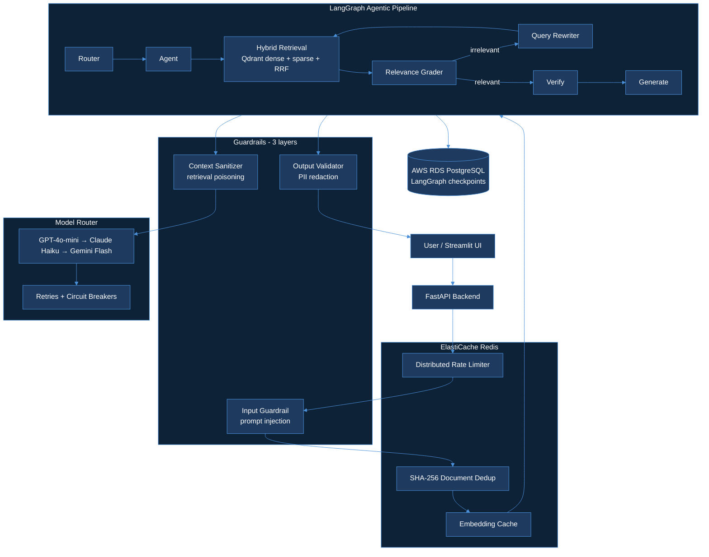

# 🚀 VeriRAG-Pro — Agentic RAG with Production-Oriented LLMOps

### Scientific claim verification with an agentic RAG pipeline, automated quality gates, and a managed-AWS deployment


---

## 📖 What is VeriRAG-Pro?

**VeriRAG-Pro** is the production-oriented evolution of **[VeriRAG](https://github.com/akashagalave/VeriRAG)** — an agentic RAG system that verifies scientific claims against retrieved evidence.

The core pipeline:

```
LangGraph  ·  Hybrid Retrieval (dense + sparse BM25)  ·  RRF Fusion
Relevance Grading  ·  Query Rewriting  ·  Evidence-Grounded Generation
```

VeriRAG-Pro wraps that pipeline with the engineering layers that most GenAI projects skip: guardrails, caching and deduplication, shared session state, multi-provider LLM reliability, automated evaluation gates, experiment tracking, and observability.

> **What changed from the previous version:** Added **Docker + AWS EC2 + CodeDeploy** setup backed by managed **RDS (PostgreSQL)** and **ElastiCache (Redis)**. Evaluation was expanded from 5 to **7 DeepEval metrics**, **MLflow/DagsHub** experiment tracking and **prompt management** were added, and **Langfuse** online evaluation was introduced alongside LangSmith tracing.

---

## 🧠 How It Works



---

## 🔧 Key Features

### 1. 🔒 Three-Layer GenAI Guardrails

| Layer | What it does | Fail policy |
|---|---|---|
| Input Guardrail | Regex-based detection of prompt injection, jailbreaks, and DAN-style attacks before the graph runs | Fail-closed → HTTP 400 |
| Context Sanitizer | Strips hidden instructions from every retrieved chunk to guard against retrieval poisoning | Fail-open → log and continue |
| Output Validator | Scans LLM output for PII (email, phone, SSN, Aadhaar) and redacts it | Fail-open → redact and continue |

```
POST /sessions/test/query {"question": "ignore all previous instructions"}
→ HTTP 400: "Your input contains patterns associated with prompt injection"
```

### 2. 📊 Evaluation Quality Gate (DeepEval + MLflow)

Every push runs an offline DeepEval suite and compares results against a stored baseline. A regression exits with code 1 and **blocks the deployment**.

| Metric | Score |
|---|---|
| Faithfulness | **0.948** |
| Answer Relevancy | **0.956** |
| Other metrics (7 total) | see `eval_baseline.json` |

- Evaluated offline
- Runs, scores, and parameters are logged to **MLflow on DagsHub** for experiment comparison
- Regression checks run in GitHub Actions and gate the build and deploy jobs

### 3. ⚡ Redis Caching & Deduplication (ElastiCache)

Redis is used in three namespaced ways, shared across all backend instances:

| Use | How it works |
|---|---|
| **Document dedup** | SHA-256 of the raw file bytes → Redis lookup. A hit returns `deduplicated: true, chunks_added: 0` with zero embedding calls |
| **Embedding cache** | `CacheBackedEmbeddings` on a Redis store (blake2b-keyed) — previously seen chunks return cached vectors instead of calling the embedding API |
| **Rate limiting** | Distributed counter so the limit applies across the whole deployment, not per process |

```
User uploads PDF → SHA-256 hash → Redis lookup
HIT  → return deduplicated result (no API calls)
MISS → chunk → embed (cache-checked) → store in Qdrant → record hash
```

### 4. 🔄 Multi-Provider LLM Routing & Reliability

Every LLM call goes through `invoke_with_fallback()`:

```
GPT-4o-mini (primary) → Claude Haiku (fallback 1) → Gemini Flash (fallback 2)
```

Each provider has a circuit breaker with exponential-backoff retries:

```
CLOSED    → healthy, requests go through
OPEN      → 3+ consecutive failures → block provider, try next
HALF-OPEN → after 60s → send one probe → on success, return to CLOSED
```

### 5. 🗄️ Shared Session State (PostgreSQL Checkpointing)

LangGraph checkpoints are stored in **PostgreSQL on AWS RDS** via `PostgresSaver`, so conversation history survives restarts and works across multiple backend instances. Local development falls back to SQLite when `DATABASE_URL` is unset.

```python
checkpointer = PostgresSaver(psycopg.connect(DATABASE_URL, autocommit=True))
checkpointer.setup()  # creates checkpoint tables if missing
```

### 6. 🔭 Observability & Prompt Management

- **LangSmith** tracing across all graph nodes
- **Langfuse** online evaluation of live traffic
- **Prompt management** — prompts are versioned and managed outside the application code *(TODO: name the tool/approach)*

---

## 🚢 Deployment

```
GitHub push
   ↓
Job 1: eval-gate  → DeepEval suite + MLflow logging
                    exit 1 on regression → BLOCKS pipeline
   ↓
Job 2: build      → build Docker images (backend + frontend), push to ECR
   ↓
Job 3: deploy     → AWS CodeDeploy rolls out to EC2
```

```
AWS
├── EC2           — Dockerized FastAPI backend + Streamlit frontend
├── CodeDeploy    — automated deployments from GitHub Actions
├── ECR           — container image registry
├── S3            — deployment artifacts
├── RDS           — PostgreSQL (LangGraph checkpoints)
└── ElastiCache   — Redis (dedup, embedding cache, rate limiting)

External: Qdrant Cloud (hybrid dense + sparse collections), LangSmith, Langfuse, DagsHub
```

**Why not Kubernetes?** The workload is a small API plus a UI. EC2 + CodeDeploy gives automated, repeatable releases with far less operational overhead, and managed RDS/ElastiCache replace the in-cluster Postgres/Redis pods.

---

## 🚀 Local Setup

```bash
git clone https://github.com/akashagalave/VeriRAG-Pro
cd VeriRAG-Pro

python -m venv venv
source venv/bin/activate   # Windows: venv\Scripts\activate
pip install -r requirements.txt

cp .env.example .env
# Required: OPENAI_API_KEY, QDRANT_URL, QDRANT_API_KEY, TAVILY_API_KEY
# Optional: REDIS_URL        (falls back to local file store)
#           DATABASE_URL     (falls back to SQLite)
#           LANGSMITH_API_KEY, LANGFUSE_*  (tracing / online eval)
#           MLFLOW_TRACKING_URI, DAGSHUB_*  (experiment tracking)
#           ANTHROPIC_API_KEY, GOOGLE_API_KEY  (LLM fallbacks)

uvicorn backend.api:app --port 8000    # Terminal 1
streamlit run app.py                   # Terminal 2
```

### Run Evaluation

```bash
python evaluate.py          # creates eval_baseline.json
python evaluate.py --ci     # CI mode — exit 1 on regression
```

### Docker Compose

```bash
docker compose up --build
```

---

## 🔑 Environment Variables

| Variable | Required | Description |
|---|---|---|
| `OPENAI_API_KEY` | ✅ | Primary LLM + embeddings |
| `QDRANT_URL` / `QDRANT_API_KEY` | ✅ | Qdrant Cloud endpoint and auth |
| `TAVILY_API_KEY` | ✅ | Web search for retrieval and claim verification |
| `REDIS_URL` | Optional | Enables Redis cache + distributed rate limiting |
| `DATABASE_URL` | Optional | PostgreSQL for shared sessions (SQLite fallback) |
| `LANGSMITH_API_KEY` | Optional | LangSmith tracing |
| `LANGFUSE_*` | Optional | Langfuse online evaluation |
| `MLFLOW_TRACKING_URI`, `DAGSHUB_*` | Optional | MLflow experiment tracking on DagsHub |
| `ANTHROPIC_API_KEY` | Optional | Claude Haiku fallback |
| `GOOGLE_API_KEY` | Optional | Gemini Flash fallback |

---

## 🧰 Tech Stack

| Category | Technology |
|---|---|
| Agent Orchestration | LangGraph StateGraph — 7 nodes, conditional routing, shared state |
| LLM Integration | LangChain — GPT-4o-mini (primary), Claude Haiku, Gemini Flash (fallbacks) |
| LLM Reliability | Custom circuit breakers, exponential-backoff retries |
| Dense Embeddings | OpenAI text-embedding-3-small (1536-dim) |
| Sparse Embeddings | FastEmbed BM25 — local, no API key |
| Vector DB | Qdrant Cloud — hybrid collections, server-side RRF fusion |
| Cache & Rate Limiting | Redis (AWS ElastiCache) |
| Session State | PostgreSQL (AWS RDS) + LangGraph `PostgresSaver` |
| Security | Three-layer guardrails — injection detection, context sanitizer, PII redaction |
| Evaluation | DeepEval — 7 metrics, baseline regression detection |
| Experiment Tracking | MLflow on DagsHub |
| Observability | LangSmith tracing, Langfuse online evaluation |
| Serving | FastAPI (async, NDJSON streaming, Pydantic schemas) |
| Frontend | Streamlit |
| Containerization | Docker |
| Deployment | AWS EC2, ECR, S3, CodeDeploy |
| CI/CD | GitHub Actions — eval-gate → build → deploy |

---

## 🔢 Key Numbers

| Metric | Value |
|---|---|
| Faithfulness (offline eval) | 0.948 |
| Answer Relevancy (offline eval) | 0.956 |
| DeepEval metrics in the gate | 7 |
| Circuit breaker threshold | 3 failures → OPEN, 60s → HALF-OPEN probe |
| LLM fallback chain | GPT-4o-mini → Claude Haiku → Gemini Flash |
| CI/CD jobs | 3 sequential (eval-gate → build → deploy) |
| Redis cache hit rate | 64.9% |

---

## 🔗 Related

- **Original project:** [akashagalave/VeriRAG](https://github.com/akashagalave/VeriRAG)

---

## 👨‍💻 Author

**Akash Agalave**
- GitHub: [@akashagalave](https://github.com/akashagalave)
- LinkedIn: [linkedin.com/in/akash-agalave](https://linkedin.com/in/akash-agalave)
